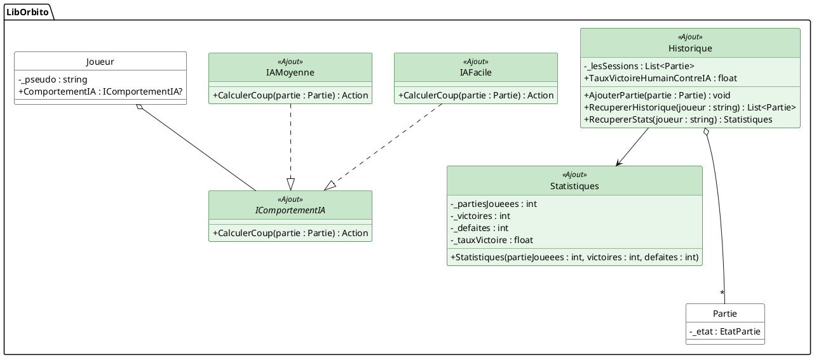

```plantuml
@startuml
hide circle
allowmixing
skinparam classAttributeIconSize 0
skinparam classBackgroundColor #ffffff
skinparam classFontColor #black
skinparam classFontName Tahoma
left to right direction

namespace LibOrbito {
    Class Statistiques {
        - _partiesJoueees : int
        - _victoires : int
        - _defaites : int
        - _tauxVictoire : float
        + PartiesJouees : int
        + Victoires : int
        + Defaites : int
        + TauxVictoire : float
        + Statistiques(partieJoueees : int, victoires : int, defaites : int)
        + ToString() : string
    }

    Class Historique {
        - _lesSessions : List<Partie>
        + TauxVictoireHumainContreIA : float
        + lesJoueurs : List<Joueur>
        + LesParties : IReadOnlyList<Partie>
        + NbParties : int
        + AjouterPartie(partie : Partie) : void
        + RecupererHistorique(joueur : string) : List<Partie> 
        + RecupererStats(joueur : string) : Statistiques
        - EstPresentDansPartie(p : Partie, pseudo : string) : bool
        - AjouterSiExistant(j : Joueur) : void
        - ActualiserListeJoueurs(p : Partie) : void
        - CalculerTauxVictoireHumainContreIA() : float
        + ToString() : string
    }
    
    enum PhaseTour {
        ChoixDeplacementAdverse
        DestinationDeplacement
        PlacementBille
        AttenteBouton
    }

    class OrbitoManager {
        + readonly _partie : Partie 
        - _positionSource : Position? 
        + PhaseActuelle : PhaseTour 
        + MessagePhase : string
        + MessageEtat : string 
        + MessageErreur : string
        + NomJoueur : string 
        + NomGagnant : string
        + AffichagePlateau : string 
        + EstTourIA : bool
        + event OnActionIADetaillee : Action<string>?

        + OrbitoManager(nomJ1 : string, avatarJ1 : string, nomJ2 : string, avatarJ2 : string, mode : ModeJeu, difficulte : DifficulteIA?)
        + ActionnerBouton() : void
        - TraiterSelectionAdverse(p : Position) : void
        - TraiterDestinationAdverse(p : Position) : void
        - TraiterPlacementBille(p : Position) : void
        + GererAction(X : int, Y : int) : void
        + FaireJouerIA() : void
        + EstTerminee() : bool 
    }
    
    enum Couleur {
        Blanc
        Noir
    }

    enum ModeJeu {
        HumainVsHumain
        HumainVsIA
        IAVsIA
    }

    enum EtatPartie {
        EnCours
        Terminee
        Egalite
    }
    
    enum DifficulteIA {
        Facile
        Moyen
    }

    Class Partie {
        - _mode : ModeJeu
        - _etat : EtatPartie
        - _compteurTours : int 
        - _coupsJoues : List<Coup> 
        - _bufferOrigine : Position?
        - _bufferDestination : Position?
        - _bufferPlacement : Position?
        - Joueur1 : Joueur 
        - Joueur2 : Joueur 
        + Mode : ModeJeu 
        + Etat : EtatPartie 
        + CompteurTours : int 
        + CoupsJoues : IReadOnlyList<Coup>
        + DateDeCreation : DateTime 
        + LePlateau : Plateau
        + JoueurCourant : Joueur
        + JoueurGagnant : Joueur? 
        
        + Partie(nomJ1 : string, avatarJ1 : string, nomJ2 : string, avatarJ2 : string, mode : ModeJeu, difficulte : DifficulteIA?)
        + VerifierVictoire() : Joueur?
        + EstTerminee() : bool 
        + ChangerJoueurCourant() : void 
        + PoserBille(p : Position) : bool 
        + DeplacerBilleAdverse(source : Position, dest : Position) : bool
        + AppuyerBoutonOrbito() : bool
        + AffichagePlateau() : string
        + EstBilleAdverse(p : Position) : bool
    }

    Class Joueur {
        - _pseudo : string
        - _avatar : string
        - _couleurBilles : Couleur
        - _billesRestantes : int
        + Pseudo : string 
        + Avatar : string  
        + CouleurBilles : Couleur 
        + BillesRestantes : int 
        + ComportementIA : IComportementIA?
        + EstIA : bool 
        + Joueur(pseudo : string, avatar : string, couleur : Couleur, comportement : IComportementIA?)
        + placerBille() : void 
    }

    interface IComportementIA {
        + CalculerCoup(partie : Partie) : Action
    }

    Class IAFacile {
        - _rnd : Random
        + CalculerCoup(partie : Partie) : Action
        - ObtenirCasesVides(plateau : Plateau) : List<Position>
        - ObtenirDeplacementsValides(plateau : Plateau, couleurAdverse : Couleur) : List<(Position, Position)>
    }

    Class IAMoyenne {
        - _rnd : Random
        + CalculerCoup(partie : Partie) : Action
        - AdversairePeutGagner(plateau : Plateau, couleurAdverse : Couleur, maCouleur : Couleur, tour : int) : bool
        - CopierPlateau(original : Plateau) : Plateau
        - AppliquerCoup(plateau : Plateau, action : Action, couleur : Couleur) : void
        - GenererTousLesCoupsLegaux(plateau : Plateau, couleurJoueur : Couleur, couleurAdverse : Couleur, tour : int) : List<Action>
        - ObtenirCasesVides(plateau : Plateau) : List<Position>
    }

    Class Plateau {
        - _tabJeu : Bille?[,]? 
        - _rayon : int 
        + TabJeu : Bille?[,] 
        + Rayon : int
        + Plateau(rayon : int = 2)
        + Initialiser() : void 
        + EstCaseLibre(p : Position) : bool 
        + AjouterBille(b : Bille, p : Position) : bool 
        + DeplacerBille(origine : Position, destination : Position) : bool 
        + At(p : Position) : Bille? 
        + ToString() : string
        + ActionnerOrbite() : bool 
        + DetecterAlignement() : (bool, bool) 
    }

    Class Bille {
        - couleur : Couleur
        + CouleurB : Couleur
        + Bille(c : Couleur)
    }

    Class Position {
        + X : int
        + Y : int
        + Position(x : int, y : int)
        + EstAdjacente(autre : Position) : bool
    }

    Class Action {
        + origineDeplacement : Position? 
        + destinationDeplacement : Position? 
        + placement : Position?
        + Action(origineDeplacement : Position?, destinationDeplacement : Position?, placement : Position?)
    }

    Class Coup {
        + Responsable : Joueur
        + Coup(origine : Position?, destination : Position?, placement : Position?, responsable : Joueur)
    }
}

LibOrbito.Partie *-- "- LePlateau" LibOrbito.Plateau
LibOrbito.Partie --> LibOrbito.Joueur
LibOrbito.Partie *-- "- _coupsJoues *" LibOrbito.Coup
LibOrbito.Coup --|> LibOrbito.Action  

LibOrbito.IAFacile ..|> LibOrbito.IComportementIA
LibOrbito.IAMoyenne ..|> LibOrbito.IComportementIA
LibOrbito.Joueur o-- LibOrbito.IComportementIA

LibOrbito.Plateau --> LibOrbito.Bille
LibOrbito.Bille --> LibOrbito.Couleur

LibOrbito.Historique o--- "- _lesSessions *" LibOrbito.Partie
LibOrbito.Historique --> LibOrbito.Joueur
LibOrbito.Historique --> LibOrbito.Statistiques

LibOrbito.OrbitoManager --> LibOrbito.Partie : "utilise"
LibOrbito.OrbitoManager --> LibOrbito.Position : "manipule"
@enduml
```

### Description générale de l'architecture

Ce diagramme de classes représente le fonctionnement du jeu Orbito (LibOrbito). Tout tourne autour de la classe `Partie`, qui gère les interactions entre les joueurs (`Joueur`) et le plateau de jeu (`Plateau`). La classe `OrbitoManager` nous sert de lien pour faciliter la communication entre la logique du jeu et l'interface graphique (la vue), pour que les deux soient bien séparés.

## Diagramme des parties ajoutées

Afin de mettre en évidence les fonctionnalités ajoutées au sujet de base, voici un diagramme ciblé sur l'IA et la gestion des historiques. (Les classes en vert sont nos ajouts majeurs).

### Description des parties ajoutées

Nous avons ajouté deux fonctionnalités majeures au sujet de base pour améliorer notre projet :

1. **Système d'IA** : 
   Nous avons créé une interface `IComportementIA` pour séparer l'intelligence artificielle de la classe `Joueur`. Les classes `IAFacile` et `IAMoyenne` utilisent cette interface. De cette façon, on peut changer la difficulté de l'IA facilement sans avoir à modifier le code de la classe `Joueur`. Cela nous permet aussi de pouvoir rajouter de nouvelles difficultés plus tard (comme une *IADifficile*) très simplement.

2. **Gestion de l'historique et des statistiques** : 
   Les classes `Historique` et `Statistiques` ont été ajoutées pour sauvegarder les parties terminées et afficher les scores des joueurs. La classe `Historique` contient une liste de `Partie`. Elle sert à retrouver les anciennes parties d'un joueur et à créer des objets `Statistiques` (qui stockent le nombre de victoires, défaites et le taux de victoire). Cela permet d'alléger la classe `Partie` pour qu'elle s'occupe uniquement du jeu en cours.

---

### Explication de nos choix d'architecture

Pour organiser notre code de la manière la plus propre possible, nous avons fait plusieurs choix :

1. **La séparation entre OrbitoManager et Partie** : 
   La classe `Partie` contient toutes les règles strictes du jeu Orbito (les tours, le plateau, les conditions de victoire). En revanche, `OrbitoManager` s'occupe de faire le chef d'orchestre : il traduit ce qui se passe dans l'interface (comme un clic du joueur) en actions pour le jeu. Si on décidait de changer complètement l'interface un jour, le code de la `Partie` resterait exactement le même. De plus le manager nous permet de faire évoluer plus facilement le jeu.

2. **L'indépendance du Plateau** : 
   La classe `Plateau` gère sa propre grille. C'est elle qui s'occupe de poser les billes, de les déplacer et de détecter si 4 billes sont alignées. Cela nous évite d'avoir une classe `Partie` géante et compliquée. Le plateau est pensé comme un objet réel : il connaît ses propres cases, mais ce n'est pas lui qui décide à qui c'est le tour de jouer. Ce choix a été fait pour faciliter l'implémentation des variantes de jeu.

3. **L'utilisation d'Enums** :
   Plutôt que d'utiliser de simples textes ou des numéros pour désigner les couleurs (`Blanc`, `Noir`), l'état du jeu ou le mode de jeu, nous avons créé des "enums" (comme `Couleur` ou `EtatPartie`). Cela permet d'éviter les fautes de frappe et rend le code beaucoup plus facile à lire et à comprendre ainsi que à maintenir pour nos évolutions.

4. **Sauvegarder les actions avec la classe Coup** :
   Au lieu de juste retenir des coordonnées, nous avons créé une classe `Coup` (qui hérite de `Action`). Cela nous permet de garder en mémoire l'historique exact de tout ce qui a été joué pendant un tour (qui a joué, déplacement de où vers où, et où a été placée la nouvelle bille).
