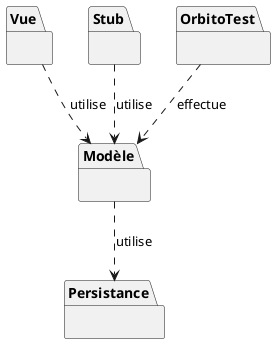
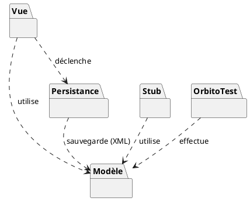

### Description de l'architecture en paquets

- **Le Modèle** : C'est le cœur du jeu. Il contient toutes les règles d'Orbito, le fonctionnement du plateau, des joueurs et de l'Intelligence Artificielle. Il est complètement indépendant et ne s'occupe pas de l'affichage.
- **La Vue** : C'est l'interface graphique (ce que le joueur voit sur son écran et avec quoi il interagit). Elle "utilise" le Modèle pour savoir quoi afficher et pour lui envoyer les actions du joueur (comme les clics).
- **OrbitoTest** : Ce paquet contient tous nos tests. Il effectue des vérifications directement sur le Modèle pour s'assurer que les règles du jeu n'ont pas de bugs, sans avoir besoin de lancer l'interface graphique.
- **Le Stub** : Ce paquet contient de fausses données (des joueurs fictifs et un historique pré-rempli) que l'on utilise provisoirement pour tester le jeu plus facilement en particulier l'affichage de l'historique et les statistiques.
- **La Persistance** : Ce paquet servira à gérer la sauvegarde (pour ne pas perdre l'historique quand on ferme le jeu). Pour l'instant on ne l'a pas implémenté ni compris totalement, mais on sait déjà que le Modèle l'utilisera pour enregistrer les données.

---

## Mise à jour (Mai 2026) - Diagramme de paquetage mis à jour

Voici l'évolution du diagramme de paquetage, maintenant que la sauvegarde a été implémentée dans notre code.

### Fonctionnement de la Persistance

Maintenant que la persistance est terminée, voici comment elle marche :

1. **La Sérialisation (XML)** : La persistance fonctionne grâce à un mécanisme appelé "sérialisation". Nous utilisons `DataContractSerializer`. Son but est de prendre les objets complexes de notre Modèle (la classe `Historique`) et de les transformer en un fichier texte structuré (au format XML). Ce fichier est ensuite stocké sur le disque dur de l'ordinateur.
2. **Le chargement (Désérialisation)** : Au lancement du jeu, la persistance fait l'opération inverse. Elle va lire le fichier XML et le retransformer en vrais objets pour restaurer l'historique tel qu'on l'avait laissé.
3. **Le lien avec le Modèle** : Pour que le `DataContractSerializer` ait le droit de lire et sauvegarder nos classes du Modèle, nous avons dû leur ajouter des attributs (`[DataContract]` sur la classe et `[DataMember]` sur les variables à sauvegarder).
4. **Le déclenchement par la Vue** : C'est la Vue (l'application graphique) qui décide à quel moment déclencher la sauvegarde ou le chargement (par exemple, quand on quitte ou qu'on lance l'application), en appelant la persistance.
