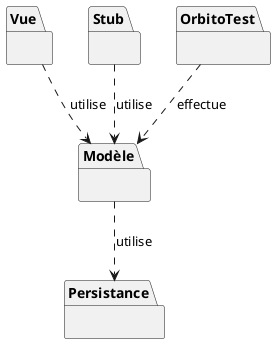

### Description de l'architecture en paquets

- **Le Modèle** : C'est le cœur du jeu. Il contient toutes les règles d'Orbito, le fonctionnement du plateau, des joueurs et de l'Intelligence Artificielle. Il est complètement indépendant et ne s'occupe pas de l'affichage.
- **La Vue** : C'est l'interface graphique (ce que le joueur voit sur son écran et avec quoi il interagit). Elle "utilise" le Modèle pour savoir quoi afficher et pour lui envoyer les actions du joueur (comme les clics).
- **OrbitoTest** : Ce paquet contient tous nos tests. Il effectue des vérifications directement sur le Modèle pour s'assurer que les règles du jeu n'ont pas de bugs, sans avoir besoin de lancer l'interface graphique.
- **Le Stub** : Ce paquet contient de fausses données (des joueurs fictifs et un historique pré-rempli) que l'on utilise provisoirement pour tester le jeu plus facilement en particulier l'affichage de l'historique et les statistiques.
- **La Persistance** : Ce paquet servira à gérer la sauvegarde (pour ne pas perdre l'historique quand on ferme le jeu). Pour l'instant on ne l'a pas implémenté ni compris totalement, mais on sait déjà que le Modèle l'utilisera pour enregistrer les données.
