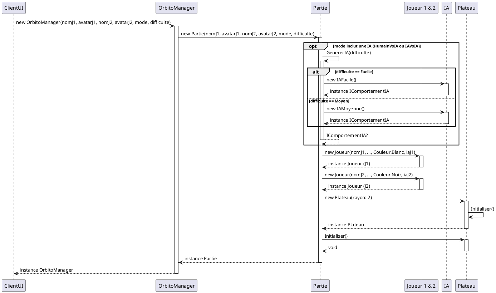
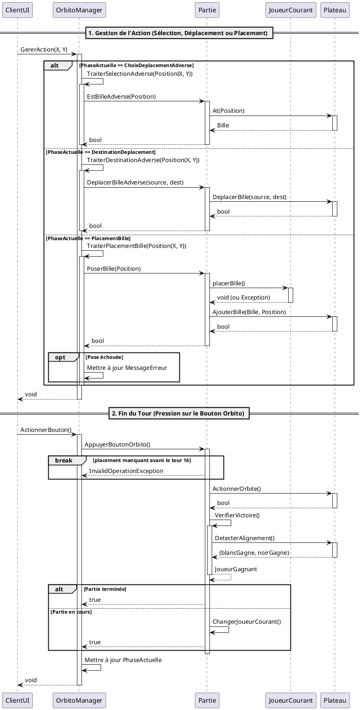
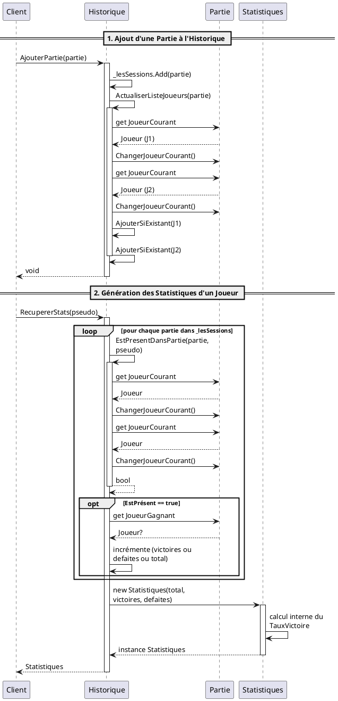
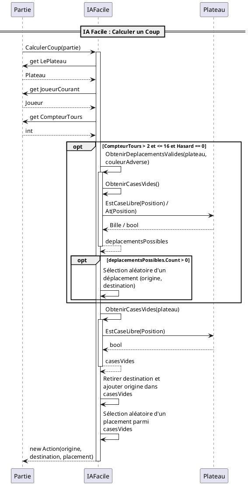
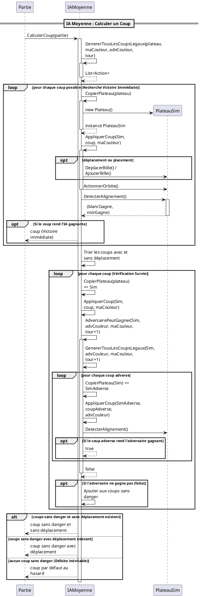

## 1. Création et initialisation d'une partie

## 2. Déroulement d'un tour de jeu

## 3. Sauvegarde et chargement de l'historique

## 4. IA Facile : Calculer un coup

## 5. IA Moyenne : Calculer un coup

### Description des diagrammes de séquence

**1. Gestion de l'Historique et des Statistiques**
Ce diagramme montre comment on sauvegarde une partie terminée et comment on génère les scores. Pour calculer les statistiques d'un joueur, la classe `Historique` parcourt toutes les anciennes parties pour compter ses victoires et ses défaites, puis crée un objet `Statistiques` avec ces calculs.

**2. Initialisation d'une nouvelle partie**
Ce diagramme explique ce qui se passe au lancement du jeu. Le `OrbitoManager` (qui fait le lien avec l'interface) crée la `Partie`. Celle-ci va ensuite préparer le `Plateau`, créer les `Joueur`s et préparer l'Intelligence Artificielle si on joue contre l'ordinateur.

**3. Déroulement d'un tour de jeu**
Ici, on voit comment le code réagit aux clics du joueur. Selon le moment du tour (choisir une bille, la déplacer ou poser une bille), le `OrbitoManager` demande à la `Partie` d'effectuer l'action. À la toute fin, quand on clique sur le bouton Orbito, le plateau effectue sa rotation et le jeu vérifie si quelqu'un a aligné 4 billes pour gagner.

**4. Intelligence Artificielle (Facile et Moyenne)**
Les deux derniers diagrammes montrent comment l'ordinateur réfléchit pour choisir son coup.
- **Pour l'IA Facile** : Elle récupère la liste des cases vides et des déplacements possibles, puis choisit son action complètement au hasard.
- **Pour l'IA Moyenne** : Elle simule tous ses coups possibles sur une copie du plateau (un faux plateau). Elle regarde d'abord si un coup la fait gagner immédiatement. Si ce n'est pas le cas, elle va tester les futurs coups du joueur adverse pour essayer de ne choisir que des actions "sans danger" (pour ne pas perdre bêtement au tour suivant).
