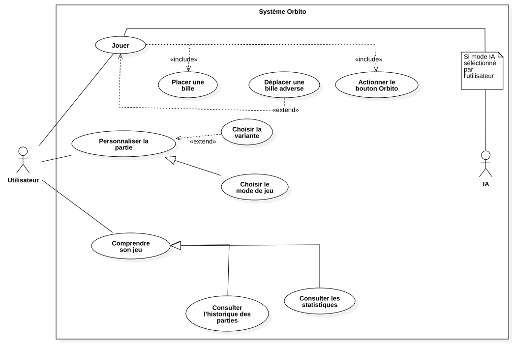

# Jouer 

| USE CASE                  | "Jouer"                                                                                                                           |
| :------------------------ | --------------------------------------------------------------------------------------------------------------------------------- |
| Pré-conditions            | -Avoir lancé l'application -Avoir Choisi son mode de jeu et les pseudos de joueurs (dans le cas d'une partie non IA VS IA)  |
| Conditions de fin réussie | L'utilisateur voit l'écran de partie s'afficher                                                                                   |
| Condition de fin échouée  | L'utilisateur se voit revenir sur la page de personnalisation de partie                                                           |
| Niveau                    | Tache primaire                                                                                                                    |
| Acteur Principal          | Utilisateur de l'application                                                                                                      |
| Acteur secondaire         | Système de vérification                                                                                                           |

| Scénario principal      | Pas         | Actions/Descriptions pas                                                                           |
| :---------------------- | ----------- | -------------------------------------------------------------------------------------------------- |
|                         | 1           | L'utilisateur clique sur le texte jouer                                                            |
|                         | 2           | Le Système vérifie que le joueur a bien sélectionné un mode de jeu                                 |
|                         | 3           | Le Système vérifie que l'utilisateur a bien saisi les informations joueurs                         |
|                         | 4           | Le joueur entre dans la partie. Le plateau s'affiche                                               |
| **Variante/Extensions** | **Pas**     | **Actions/Descriptions pas**                                                                       |
|                         | 2a.1        | Le Système renvoie un code d'erreur, le joueur n'a pas sélectionné son mode de jeu                 |
|                         | 3a.1        | Le Système renvoie un code d'erreur, le joueur n'a pas saisi les pseudonymes et choisi les avatars |
|                         | 2a et 3a .2 | Le joueur est renvoyé a la page de personnalisation                                                |

### Placer une bille

| USE CASE                  | "Placer une bille"                                                                                                                                                                   |
| :------------------------ | ------------------------------------------------------------------------------------------------------------------------------------------------------------------------------------ |
| Pré-conditions            | -Avoir lancé l'application -C'est au tour du joueur de jouer -Avoir validé son bouton "jouer" -Être sur le plateau de jeu -Le joueur a(ou non) déplacé une bille adverse |
| Conditions de fin réussie | L'utilisateur voit sa bille sur le plateau                                                                                                                                           |
| Condition de fin échouée  | L'utilisateur voit un message d'erreur personnalisé                                                                                                                                  |
| Niveau                    | Tache incluse                                                                                                                                                                        |
| Acteur Principal          | Utilisateur de l'application                                                                                                                                                         |
| Acteur secondaire         | Système de vérification                                                                                                                                                              |

| Scénario principal      | Pas     | Actions/Descriptions pas                                                                   |
| :---------------------- | ------- | ------------------------------------------------------------------------------------------ |
|                         | 1       | L'utilisateur prend la bille sur son "deck joueur"                                         |
|                         | 2       | Le Système vérifie que le joueur a bien des billes qu'il doit poser                        |
|                         | 3       | L'utilisateur sélectionne la zone où il veut poser sa bille                                |
|                         | 4       | Le Système vérifie que l'utilisateur n'essaye pas de poser sa bille à un endroit interdit  |
|                         | 5       | Le joueur a réussi. La bille s'affiche sur le plateau                                      |
| **Variante/Extensions** | **Pas** | **Actions/Descriptions pas**                                                               |
|                         | 2a.1    | Le Système renvoie un code d'erreur, le joueur n'a plus de billes à poser                  |
|                         | 2a.2    | Le joueur est amené a appuyer sur le bouton Orbito                                         |
|                         | 3a.1    | Le Système renvoie un code d'erreur, le joueur est amené a choisir d'autres coordonnées    |
|                         | 3a.2    | Le joueur choisit d'autres coordonnées et ainsi de suite jusqu'à validité de l'emplacement |

### Déplacer une bille adverse

| USE CASE                  | "Déplacer une bille adverse"                                                                                                                             |
| :------------------------ | -------------------------------------------------------------------------------------------------------------------------------------------------------- |
| Pré-conditions            | - Être en cours de partie  - C'est au tour du joueur actuel  - Il existe au moins une bille adverse déplaçable sur le plateau                      |
| Conditions de fin réussie | La bille adverse est déplacée sur une case adjacente libre                                                                                               |
| Condition de fin échouée  | La bille reste à sa position d'origine, un message d'erreur s'affiche                                                                                    |
| Niveau                    | Tâche d'extension (Extend de "Jouer")                                                                                                                    |
| Acteur Principal          | Utilisateur de l'application                                                                                                                             |
| Acteur secondaire         | Système de vérification                                                                                                                                  |

| Scénario principal      | Pas     | Actions/Descriptions pas                                                                    |
| :---------------------- | ------- | ------------------------------------------------------------------------------------------- |
|                         | 1       | L'utilisateur sélectionne une bille appartenant à l'adversaire                              |
|                         | 2       | Le Système vérifie que la bille peut être déplacée (case adjacente libre)                   |
|                         | 3       | L'utilisateur sélectionne la nouvelle case (adjacente et vide)                              |
|                         | 4       | Le Système valide le déplacement et met à jour l'affichage du plateau                       |
| **Variante/Extensions** | **Pas** | **Actions/Descriptions pas** |
|                         | 2a.1    | Le Système renvoie un code d'erreur, la bille sélectionnée n'a pas de case adjacente libre  |
|                         | 3a.1    | L'utilisateur tente de déplacer la bille sur une case invalide, le système refuse           |
|                         | 2a/3a.2 | L'utilisateur est invité à sélectionner une autre bille ou une autre case                   |

### Actionner le bouton Orbito

| USE CASE                  | "Actionner le bouton Orbito"                                                                                                           |
| :------------------------ | -------------------------------------------------------------------------------------------------------------------------------------- |
| Pré-conditions            | - Être en cours de partie  - Avoir terminé la phase de placement de sa bille (et éventuellement le déplacement d'une bille adverse) |
| Conditions de fin réussie | Le plateau effectue sa rotation et l'état du jeu est mis à jour                                                                        |
| Condition de fin échouée  | La rotation ne s'effectue pas et l'utilisateur est invité à réessayer                                                                  |
| Niveau                    | Tâche incluse                                                                                                                          |
| Acteur Principal          | Utilisateur de l'application / IA (si mode IA sélectionné)                                                                             |
| Acteur secondaire         | Système de vérification                                                                                                                |

| Scénario principal      | Pas     | Actions/Descriptions pas                                                   |
| :---------------------- | ------- | -------------------------------------------------------------------------- |
|                         | 1       | L'utilisateur clique sur le bouton central du plateau                      |
|                         | 2       | Le Système déclenche l'animation de rotation du plateau                    |
|                         | 3       | Le Système recalcule les nouvelles positions de toutes les billes          |
|                         | 4       | Le Système vérifie les conditions de victoire post-rotation                |
| **Variante/Extensions** | **Pas** | **Actions/Descriptions pas**                                               |
|                         | 4a.1    | Le Système détecte un alignement gagnant et met fin à la partie            |
|                         | 4b.1    | Aucun alignement n'est détecté, le système passe le tour au joueur suivant |

# Personnaliser la partie 

| USE CASE                  | "Personnaliser la partie"                                                                                                                                |
| :------------------------ | -------------------------------------------------------------------------------------------------------------------------------------------------------- |
| Pré-conditions            | - Avoir lancé l'application  - Être sur le menu d'accueil ou de configuration de partie                                                               |
| Conditions de fin réussie | Les paramètres de la partie sont sauvegardés et l'utilisateur peut lancer le jeu                                                                         |
| Condition de fin échouée  | Les paramètres ne sont pas sauvegardés, l'utilisateur reste sur l'écran de personnalisation                                                              |
| Niveau                    | Tâche primaire                                                                                                                                           |
| Acteur Principal          | Utilisateur de l'application                                                                                                                             |
| Acteur secondaire         | Aucun                                                                                                                                                    |

| Scénario principal      | Pas     | Actions/Descriptions pas                                                                                                              |
| :---------------------- | ------- | ------------------------------------------------------------------------------------------------------------------------------------- |
|                         | 1       | L'utilisateur accède au menu de personnalisation de la partie et choisit son mode de jeu (Humain VS Humain , Humain VS IA, IA VS IA ) |
|                         | 2       | L'utilisateur clique sur le bouton "Jouer"                                                                                            |
|                         | 3       | Le Système enregistre les modifications via le bouton "Lancer la partie"                                                              |
| **Variante/Extensions** | **Pas** | **Actions/Descriptions pas**                                                                                                          |
|                         | 2a.1    | Si le mode IA VS IA est séléctionné, la partie se lance                                                                               |
|                         | 2b.1    | Sinon L'utilisateur voit la page de personnalisation des pseudos, il modifie les options souhaitées (pseudos, avatars, etc.)          |

### Choisir le mode de jeu

| USE CASE                  | "Choisir le mode de jeu"                                                            |
| :------------------------ | ----------------------------------------------------------------------------------- |
| Pré-conditions            | - Être dans le menu de personnalisation de la partie - Avoir lancé l'application |
| Conditions de fin réussie | Un mode de jeu valide (ex: Joueur vs Joueur, Joueur vs IA) est sélectionné          |
| Condition de fin échouée  | Aucun mode n'est sélectionné, ce qui bloquera le lancement de la partie             |
| Niveau                    | Spécialisation                                                                      |
| Acteur Principal          | Utilisateur de l'application                                                        |
| Acteur secondaire         | Aucun                                                                               |

| Scénario principal | Pas | Actions/Descriptions pas                                                |
| :----------------- | --- | ----------------------------------------------------------------------- |
|                    | 1   | L'utilisateur visualise les différents modes de jeu disponibles         |
|                    | 2   | L'utilisateur clique sur le mode de jeu de son choix (ex: Joueur VS IA) |
|                    | 3   | Le Système actualise les options liées au mode                          |

### Choisir la variante 

| USE CASE                  | "Choisir la variante"                                         |
| :------------------------ | ------------------------------------------------------------- |
| Pré-conditions            | - Être dans le menu de personnalisation de la partie          |
| Conditions de fin réussie | Les règles de la variante sont activées pour la future partie |
| Condition de fin échouée  | Les règles standard s'appliquent par défaut                   |
| Niveau                    | Tâche d'extension                                             |
| Acteur Principal          | Utilisateur de l'application                                  |
| Acteur secondaire         | Aucun                                                         |

| Scénario principal | Pas | Actions/Descriptions pas                                                                 |
| :----------------- | --- | ---------------------------------------------------------------------------------------- |
|                    | 1   | L'utilisateur sélectionne l'option pour activer une variante spécifique                  |
|                    | 2   | Le Système enregistre ce choix et prépare les règles spécifiques pour la partie suivante |

# Comprendre son jeu

| USE CASE                  | "Comprendre son jeu"                                         |
| :------------------------ | ------------------------------------------------------------ |
| Pré-conditions            | - Avoir lancé l'application                                  |
| Conditions de fin réussie | L'utilisateur accède à son espace personnel d'analyse de jeu |
| Condition de fin échouée  | L'accès est refusé ou les données sont indisponibles         |
| Niveau                    | Tâche primaire                                               |
| Acteur Principal          | Utilisateur de l'application                                 |
| Acteur secondaire         | Système de sauvegarde                                        |

| Scénario principal      | Pas     | Actions/Descriptions pas                                                             |
| :---------------------- | ------- | ------------------------------------------------------------------------------------ |
|                         | 1       | L'utilisateur clique sur la section "historique" ou "stats" dans l'écran d'acceuil   |
|                         | 2       | l'utilisateur saisit son nom de jeu si stats séléctionné                             |
|                         | 3       | Le Système récupère les données du joueur/ des parties                               |
|                         | 4       | Le Système affiche le tableau de bord de l'utilisateur                               |
| **Variante/Extensions** | **Pas** | **Actions/Descriptions pas**                                                         |
|                         | 3a.1    | Le système ne trouve pas le joueur dans ses données, il retourne "joueur non trouvé" |

### Consulter l'historique des parties

| USE CASE                  | "Consulter l'historique des parties"                                                      |
| :------------------------ | ----------------------------------------------------------------------------------------- |
| Pré-conditions            | - Avoir accédé à la section "Comprendre son jeu" - Avoir joué une ou plusieurs parties |
| Conditions de fin réussie | La liste des parties précédentes s'affiche correctement                                   |
| Condition de fin échouée  | Le système affiche un message indiquant que l'historique est vide ou inaccessible         |
| Niveau                    | Spécialisation                                                                            |
| Acteur Principal          | Utilisateur de l'application                                                              |
| Acteur secondaire         | Système de données                                                                        |

| Scénario principal      | Pas     | Actions/Descriptions pas                                                                    |
| :---------------------- | ------- | ------------------------------------------------------------------------------------------- |
|                         | 1       | L'utilisateur navigue vers l'onglet "Historique"                                            |
|                         | 2       | Le Système affiche la liste chronologique des parties (gagnées, perdues, adversaires)       |

### Consulter les statistiques

| USE CASE                  | "Consulter les statistiques"                                                                                    |
| :------------------------ | --------------------------------------------------------------------------------------------------------------- |
| Pré-conditions            | - Avoir accédé à la section "Comprendre son jeu" - Avoir joué une partie ou plus avec le pseudonyme spécifié |
| Conditions de fin réussie | Les données chiffrées (ratio, temps de jeu, etc.) s'affichent à l'écran                                         |
| Condition de fin échouée  | Les statistiques ne se chargent pas                                                                             |
| Niveau                    | Spécialisation                                                                                                  |
| Acteur Principal          | Utilisateur de l'application                                                                                    |
| Acteur secondaire         | Système de données                                                                                              |

| Scénario principal | Pas | Actions/Descriptions pas                                                                    |
| :----------------- | --- | ------------------------------------------------------------------------------------------- |
|                    | 1   | L'utilisateur navigue vers l'onglet "Statistiques"                                          |
|                    | 2   | L'utilisateur saisit son nom de jeu ( cf "Comprendre sa partie" pour le comportement exact) |
|                    | 3   | Le Système compile et affiche les données globales (pourcentage de victoire, etc.)          |