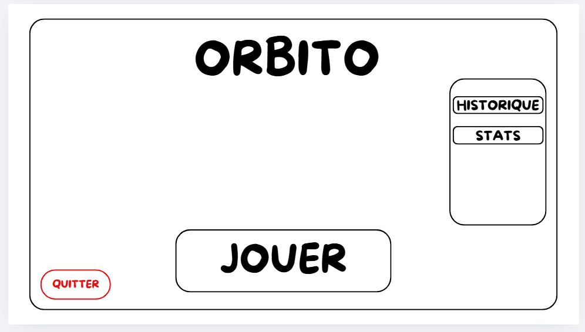
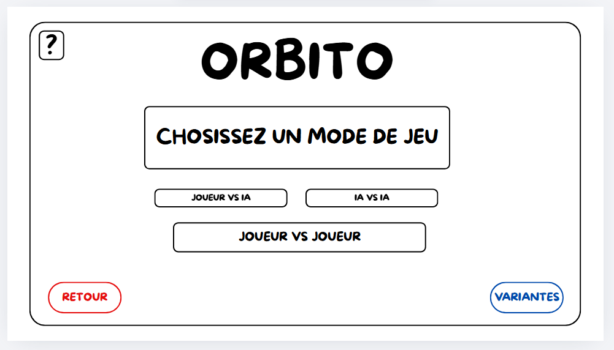
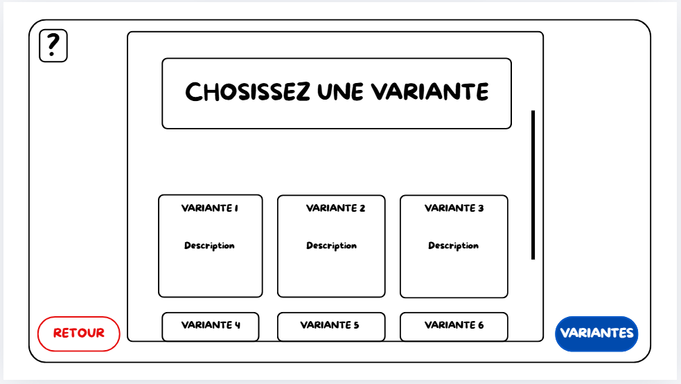
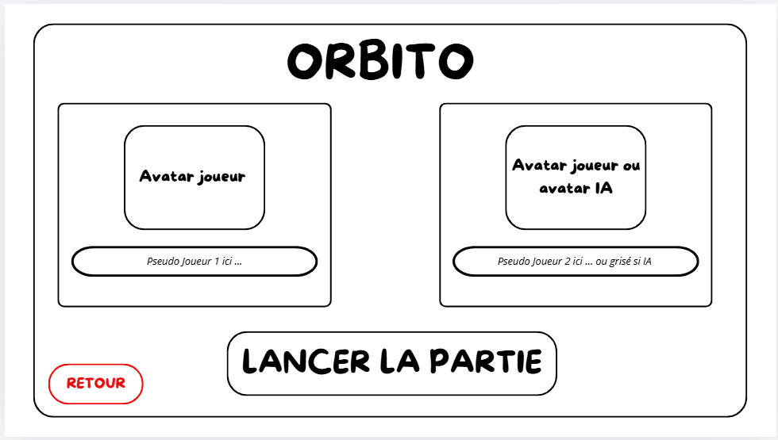
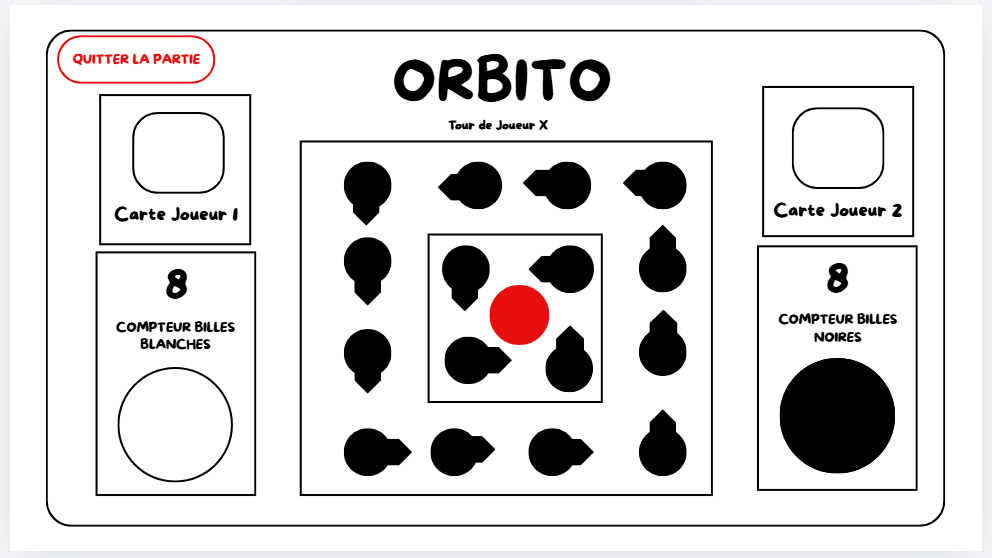
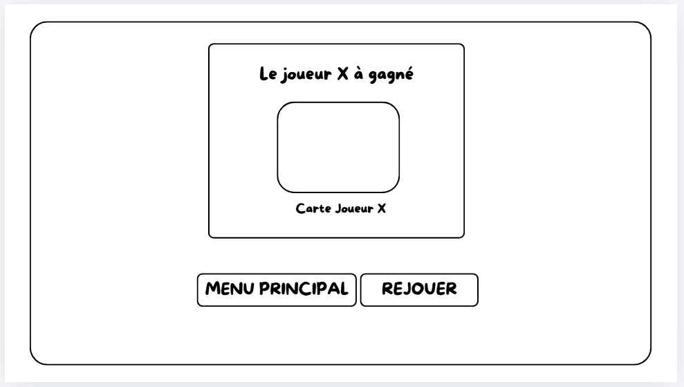
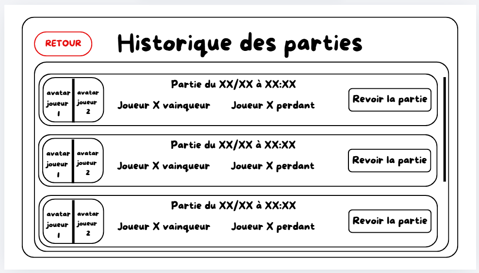
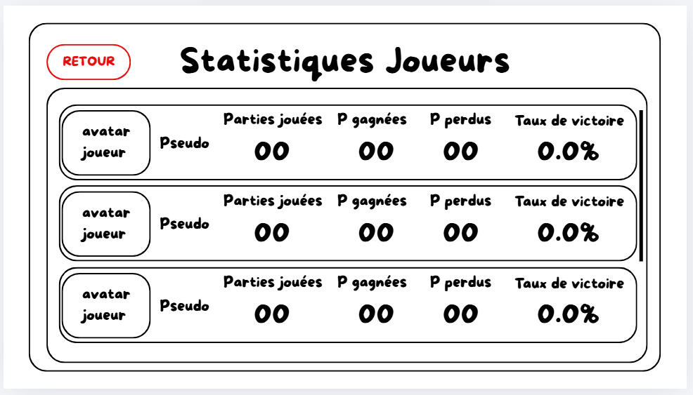

# Descriptions des Sketchs

## 1. Écran d'Accueil (Menu Principal)

 
### Description de la page
Cet écran représente le menu principal, qui sert de point d'entrée pour l'utilisateur. L'interface est minimaliste pour guider naturellement l'utilisateur vers l'action principale (Jouer au jeu) tout en gardant les options secondaires facilement accessibles (Historique et statistiques) ainsi que l'option de quitter en rouge l'application.

### Éléments de l'interface :
* **En-tête :** Le titre/logo "ORBITO" est affiché en grand, centré en haut de l'écran.
* **Action Principale :** Un grand bouton central "JOUER" permet de lancer une session. Sa taille et son placement en font l'élément central de la page.
* **Menu Secondaire (Panneau droit) :** Un bloc dédié au suivi des joueurs  :
  * **HISTORIQUE :** Permet d'accéder à la liste des sessions ou parties précédentes.
  * **STATS :** Permet d'accéder aux statistiques des joueurs.
* **Action de sortie :** Un bouton "QUITTER" placé dans le coin inférieur gauche. Son texte et son contour sont rouges pour indiquer l'action sans retour du bouton.

---

## 2. Écran de Sélection du Mode de Jeu

### Description
C'est ici qu'on choisit le type d'affrontement avant de lancer la configuration des joueurs. Le menu permet de choisir entre 3 modes d'affrontement et aussi d'accéder au choix des variantes.

### Éléments de l'interface :
* **Titre :** "CHOSISSEZ UN MODE DE JEU" pour bien indiquer l'étape.
* **Bouton point d'Interrogation :** Un bouton en haut à gauche, qui permet de connaître toutes les règles du jeu.
* **Les 3 gros boutons de choix du mode :**
  * "JOUEUR VS IA" : Pour jouer en solo contre l'ordinateur.
  * "JOUEUR VS JOUEUR" : Pour jouer contre un pote en local.
  * "IA VS IA" : Pour faire s'affronter deux bots.
* **Bouton optionnel :** Un bouton "VARIANTES" pour accéder à la page des variantes.
* **Navigation :** Un bouton "RETOUR" en bas à gauche pour revenir au menu principal.

---

## 3. Écran des Variantes

### Description
Une page dédiée aux règles spéciales. On affiche (en pop up) une grille pour que le joueur puisse comparer et choisir facilement la variante qui lui plaît pour pouvoir pimenter sa partie.

### Éléments de l'interface :
* **Titre :** "CHOSISSEZ UNE VARIANTE".
* **La grille des choix :** 6 options. Chacune contient une zone de "Description" pour expliquer brièvement en quoi ça consiste.

---

## 4. Écran de Configuration (Lobby)

### Description
Dernière étape avant le plateau. On personnalise la partie en rentrant les pseudos des joueurs et les avatars pour que le résultat final de la partie soit sauvegardé.

### Éléments de l'interface :
* **Zone Joueur 1 :** Un espace avec son "Avatar joueur" et un champ de saisie pour le "Pseudo Joueur 1".
* **Zone Joueur 2 / IA :** Même principe, avec un "Avatar joueur ou avatar IA" et un champ pour le pseudo du Joueur 2, qui sera "grisé si IA".
* **Lancement :** Un gros bouton "LANCER LA PARTIE" bien visible.
* **Navigation :** Bouton "RETOUR" pour changer le mode de jeu si on s'est trompé.

---

## 5. Écran de Jeu (Le Plateau)

### Description
L'écran principale du l'application. L'interface s'efface un peu pour laisser la place au plateau "ORBITO" au centre et aux infos des joueurs (leurs cartes et leurs compteurs de billes restantes)

### Éléments de l'interface :
* **Le Plateau :** Au centre, avec les emplacements pour les billes et le bouton d'action central.
* **Indicateur de tour :** Un texte "Tour de Joueur X" pour savoir à qui de jouer.
* **Zone d'infos Joueur 1 :** "Carte Joueur 1" avec un "Compteur de billes" ("blanches").
* **Zone d'infos Joueur 2 :** "Carte Joueur 2" avec un "Compteur de billes" ("noires").
* **Action d'urgence :** Un bouton "QUITTER LA PARTIE" en haut pour revenir au menu (si ragequit).

---

## 6. Écran de Fin de Partie

### Description
La partie est finie, on affiche clairement la carte du vainqueur et on propose d'enchaîner sur une revanche.

### Éléments de l'interface :
* **Message principal :** "Le joueur X à gagné" bien mis en avant.
* **Infos du gagnant :** La "Carte Joueur X" du vainqueur.
* **Boutons d'action :** 
	* "REJOUER" : Pour relancer direct une partie avec les même joueurs (revanche).
	* "MENU PRINCIPAL" : Pour quitter et retourner à l'accueil.

---

## 7. Écran Historique

### Description
Une liste scrollable des anciennes parties effectuée sur la machine, leurs informations importantes et la possibilité de revoir la partie.

### Éléments de l'interface :
* **Titre :** "Historique des parties".
* **Liste des matchs :** Pour chaque ligne, on voit :
  * La date et l'heure.
  * Les pseudos et avatars ("avatar joueur").
  * Qui est le vainqueur et qui est le perdant.
  * Un bouton "Revoir la partie" (fonctionnalité de replay).
* **Navigation :** Bouton "RETOUR" en haut.

---

## 8. Écran des Statistiques

### Description
La liste de tout les joueurs enregistré sur la machine ainsi que leurs statistiques.

### Éléments de l'interface :
* **Titre :** "Statistiques Joueurs".
* **Tableau de données :** Avec les colonnes suivantes :
  * L'"avatar" et le "Pseudo" du joueur.
  * Le nombre de "Parties jouées".
  * Le nombre de parties gagnées ("P gagnées") et perdues ("P perdus").
  * Le "Taux de victoire" (ex: 0.0%).
* **Navigation :** Bouton "RETOUR" pour sortir de la page.